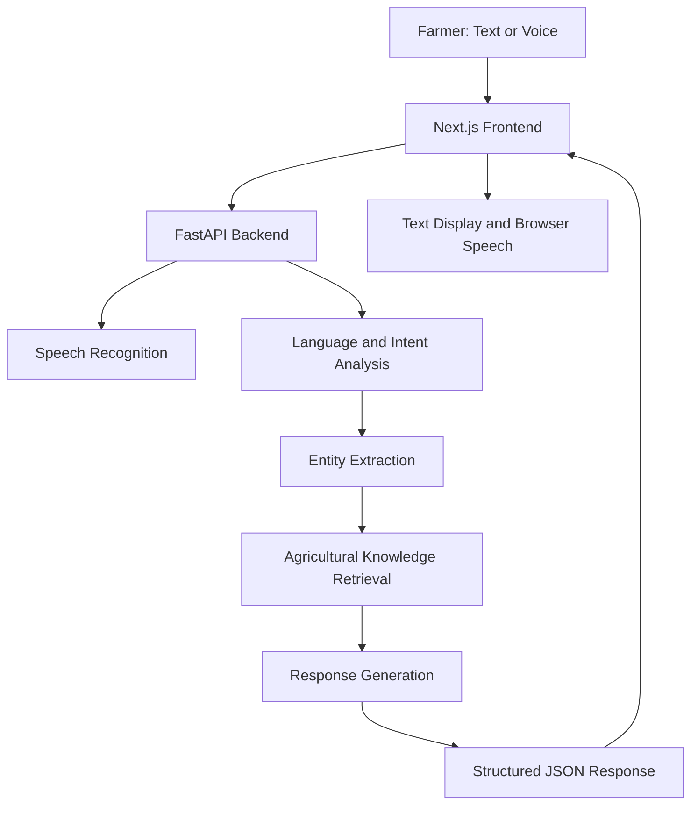

# 🌾 AI-Driven Smart Farming Assistant
### Multilingual Agricultural Guidance & Farmer Support

**An AI-powered agricultural assistant designed to make farming guidance more accessible through multilingual text and voice interactions.**

<p align="center">
  
  
  
  
  
</p>

---

## 📌 Overview

The **AI-Driven Smart Farming Assistant** is a multilingual chatbot prototype developed to help farmers access agricultural guidance in their preferred language.

Farmers may face difficulties finding reliable information about irrigation, soil health, crop management, pest-related concerns, fertilizers, and government schemes. Language barriers and limited access to digital agricultural resources can make this information harder to obtain.

This project combines a **FastAPI backend, Next.js frontend, multilingual natural language processing, speech recognition, and a structured agricultural knowledge base** to provide an accessible conversational experience.

The current Milestone 1 implementation focuses on building and validating the core NLP pipeline, backend APIs, multilingual interaction, and initial agricultural knowledge retrieval.

## ✨ Key Features

- 🌐 **Multilingual interaction:** Supports English, Hindi, and Kannada in the current prototype.
- 🎙️ **Speech recognition:** Uses Whisper and IndicConformer-based components for supported speech transcription workflows.
- 🧠 **Intent classification:** Uses a multilingual Hugging Face classification model with keyword-based fallback logic.
- 🌱 **Agricultural entity extraction:** Identifies supported crop names, agricultural topics, and selected locations using multilingual aliases.
- 📚 **Knowledge-based responses:** Retrieves relevant information from a structured JSON agricultural knowledge base.
- 🔊 **Spoken responses:** Uses browser-based speech synthesis for supported languages and available voices.
- 💬 **Session-aware conversations:** Maintains basic conversation context, including previously identified crop information.
- 🔗 **Source attribution:** Provides source information for selected knowledge-backed responses.
- 🧪 **Automated testing:** Includes backend tests and intent evaluation scripts.

## 🏗️ System Architecture



The diagram represents the intended high-level interaction flow. The current implementation uses keyword-based knowledge retrieval rather than a complete semantic vector-search RAG pipeline.

## 🛠️ Technology Stack

| Component | Technologies |
|---|---|
| Frontend | Next.js, React, TypeScript, CSS |
| Backend | Python, FastAPI |
| NLP and classification | Hugging Face Transformers, multilingual zero-shot classification |
| Speech processing | Whisper, IndicConformer, sherpa-onnx |
| Knowledge base | JSON, Python retrieval logic |
| Speech output | Browser SpeechSynthesis API |
| Testing | pytest, custom evaluation scripts |
| Version control | Git, GitHub |

**Classification model:** `MoritzLaurer/multilingual-MiniLMv2-L6-mnli-xnli`

## 📁 Project Structure

```text
INFOSYS/
├── backend/
│   ├── knowledge_base/
│   │   └── agriculture.json
│   ├── schemas/
│   │   └── chat.py
│   ├── services/
│   │   ├── intent_service.py
│   │   ├── knowledge_service.py
│   │   ├── response_service.py
│   │   ├── session_service.py
│   │   ├── speech_service.py
│   │   └── translation_service.py
│   ├── tests/
│   │   ├── test_chat.py
│   │   ├── test_intent_multilingual.py
│   │   └── test_knowledge.py
│   ├── evaluate_intents.py
│   ├── evaluate_unseen_intents.py
│   ├── main.py
│   ├── requirements.txt
│   └── MILESTONE1_REPORT.md
│
├── frontend/
│   ├── app/
│   │   ├── globals.css
│   │   ├── layout.tsx
│   │   └── page.tsx
│   ├── public/
│   │   └── manifest.json
│   ├── package.json
│   └── package-lock.json
│
└── README.md
```

## 🚀 Getting Started

### Prerequisites

Install the following before running the project:

- Python 3.12
- Node.js and npm
- Git
- A terminal and code editor

Speech-recognition components may download model files on their first use and require sufficient disk space and internet connectivity.

### 1. Clone the repository

```bash
git clone https://github.com/Springboard-Internship-2026/AI-Driven-Smart-Farming-Assistant-With-Multilingual-Agricultural-Guidance-And-Farmer-Supp-OCT-2026.git

cd AI-Driven-Smart-Farming-Assistant-With-Multilingual-Agricultural-Guidance-And-Farmer-Supp-OCT-2026
```

To inspect the submitted work, check out the submission branch:

```bash
git switch sachin-singh
```

### 2. Set up the backend

From the repository root:

```bash
cd backend

python3.12 -m venv .venv
source .venv/bin/activate

python -m pip install --upgrade pip
pip install -r requirements.txt
```

Start the FastAPI development server:

```bash
uvicorn main:app --reload
```

The backend should be available at:

- API root: http://127.0.0.1:8000/
- Health check: http://127.0.0.1:8000/health
- Interactive API documentation: http://127.0.0.1:8000/docs

Keep the backend terminal running.

### 3. Set up the frontend

Open a second terminal from the repository root:

```bash
cd frontend
npm ci
npm run dev
```

Open the application in your browser:

http://localhost:3000

The frontend expects the backend to be running. If your local configuration uses a different API URL, verify the relevant settings in the frontend source before starting the application.

### 4. Run the backend tests

Open a terminal in the backend directory and activate the virtual environment:

```bash
cd backend
source .venv/bin/activate
python -m pytest -q
```

The test results depend on the current code and environment. Refer to the latest test run rather than assuming a fixed number of passing tests.

## 🔌 Backend API Endpoints

| Method | Endpoint | Purpose |
|---|---|---|
| GET | `/` | Basic API information |
| GET | `/health` | Health check |
| POST | `/api/v1/chat` | Process a chat request |
| POST | `/api/v1/detect-language` | Detect language |
| POST | `/api/v1/speech/transcribe` | Transcribe uploaded speech |

Use the interactive Swagger documentation at `/docs` to inspect request schemas and try the available endpoints.

**Note:** The exact request fields, response schemas, and accepted audio formats are defined by the current backend implementation.

## 🧪 Testing and Evaluation

The project includes automated tests and evaluation scripts for multilingual intent classification.

Run the existing intent evaluation:

```bash
cd backend
source .venv/bin/activate
python evaluate_intents.py
```

Run the unseen-intent diagnostic evaluation:

```bash
python evaluate_unseen_intents.py
```

### Current evaluation snapshot

| Evaluation | Recorded result |
|---|---|
| Backend automated tests | 14 passed in the latest reported run |
| Existing intent test set | 65/65 correct on the current test set |
| Unseen-intent diagnostic set | 11/20 correct in the latest reported run |

These are development results, not independent benchmarks or guarantees of real-world accuracy. The existing intent set overlaps with keyword-based rules, and the unseen diagnostic results indicate that classification needs further improvement.

## ⚠️ Current Scope and Limitations

This repository represents the current Milestone 1 prototype, not the completed eight-week project.

- Knowledge retrieval currently uses keyword-based matching over structured JSON records.
- A complete vector database and semantic RAG pipeline are not yet implemented.
- Sarvam AI integration is not currently part of the working implementation.
- Speech recognition quality varies by language, recording quality, and agricultural vocabulary.
- Browser speech synthesis depends on browser and operating-system voice availability.
- Session state is maintained in memory and is not persistent across backend restarts.
- Live weather, mandi prices, and government-scheme eligibility integrations remain future work.
- Production deployment, full PWA offline support, administrative analytics, and production-grade security controls require further implementation and testing.
- Multilingual agricultural summaries require continued verification for accuracy and safety.

Agricultural guidance should be validated against reliable agricultural sources and local conditions before being used for important farming decisions.

## 🔐 Security Notes

- Never commit `.env` files, API keys, passwords, or access tokens.
- Keep virtual environments, generated build files, and local caches out of version control.
- Validate user input and uploaded files before production deployment.
- Configure appropriate CORS, authentication, rate limiting, and error handling before exposing the API publicly.

## 🗺️ Future Enhancements

- Improve multilingual intent classification and entity extraction.
- Complete evaluation of Hindi and Kannada speech recordings.
- Expand and validate the agricultural knowledge base.
- Implement semantic search and a grounded RAG pipeline.
- Integrate verified weather, market-price, and agricultural advisory sources.
- Improve voice-first mobile usability and PWA installation/offline behavior.
- Add response feedback and an administrative review workflow.
- Expand automated integration, performance, and security testing.

## 👨‍💻 Project Information

**Project:** AI-Driven Smart Farming Assistant with Multilingual Agricultural Guidance and Farmer Support

**Program:** Infosys Internship — Milestone 1

**Contributor:** Sachin Singh

**Submission branch:** `sachin-singh`

**Repository:** [Springboard Internship 2026 — Smart Farming Assistant](https://github.com/Springboard-Internship-2026/AI-Driven-Smart-Farming-Assistant-With-Multilingual-Agricultural-Guidance-And-Farmer-Supp-OCT-2026)

---

<p align="center">
  <strong>🌾 Building more accessible agricultural guidance through multilingual AI.</strong>
</p>
